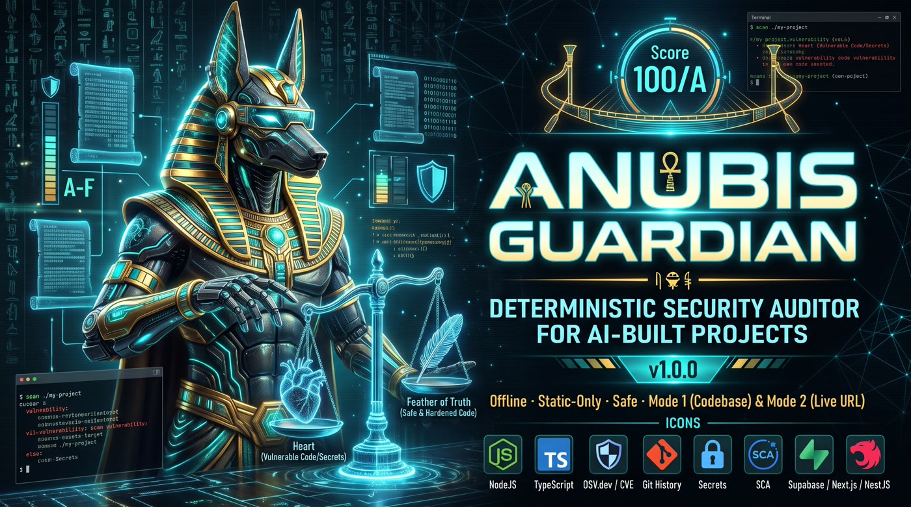
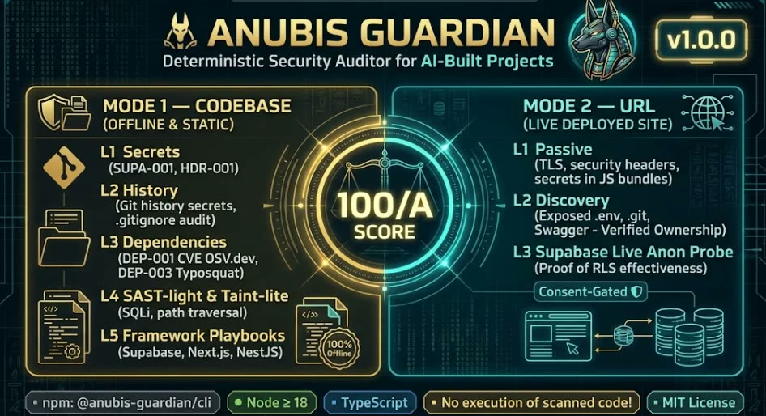

<div align="center">

# ⚱ Anubis Guardian

**Deterministic security auditor for AI-built (vibe-coded) projects**
**ماسح أمني حتمي للمشاريع المبنية بالذكاء الاصطناعي**

**Works on any stack. Supabase/Next.js is the batteries-included case.**



[](LICENSE)
[](package.json)
[](package.json)
[](tsconfig.json)
[](#-tests-regression-gates)

**Codebase audit (offline) · URL audit (consent-gated) · Secrets · Supabase RLS · Next.js · NestJS · Dependencies (OSV) · CI/supply-chain · SARIF**

> 🛡️ **Real-time AI guard, not just another scanner.** Existing tools audit *after* the damage ships. Anubis Guardian can sit in the loop **at write time**: a pinned PreToolUse hook + skill block service-role keys, RLS-killing SQL, and secrets **before they enter your codebase** — detection, prevention, and repair guidance in one tool.

[English](#-why-anubis-guardian) · [العربية](#-العربية-quick-guide)

</div>

---

## 🔍 Why Anubis Guardian

AI coding agents (Claude Code, Cursor, Bolt, Lovable, Windsurf…) ship full-stack apps in days — but with a **consistent, repeating pattern of security mistakes**: service keys shipped to the client, database passwords in request headers, missing Row-Level Security, JWTs in `localStorage`, `.env` files pushed to GitHub, unpinned CI actions.

Existing scanners (Semgrep, Trivy, Gitleaks) are powerful but generic — they were not designed for this failure pattern. **Anubis Guardian** is a deterministic, static-only security scanner built for AI-generated code — first-class playbooks for the **Supabase / Next.js / NestJS** stack, universal coverage everywhere else, and:

- **Hard honesty contracts** — secrets are masked (first-4 chars + SHA-256) in *every* output, including the optional AI-review prompt; no CRITICAL without independent confirmation
- **Byte-identical determinism** — same code + same tool version ⇒ identical `findings.json` / `fix-prompt.md`; for URL mode, one saved capture replays with zero network and identical results
- **No execution of scanned code** — file reads and git plumbing only; generated tests land in a *quarantine* folder that **you** run
- **Prevention, not just detection** — an optional pinned agent hook blocks service-role keys and RLS-killing SQL *at write time*
- **Data-driven rules** — priorities come from a study of 100 public AI-built projects (top patterns: unpinned CI actions 22% · `Math.random` tokens 11% · `dangerouslySetInnerHTML` 7% · committed `.env` 3%) — see [studies/RESULTS.md](studies/step0-pattern-study/RESULTS.md)

## 🧭 What's stack-specific vs universal

| | Coverage |
|---|---|
| **Stack-specific** *(the differentiator — deep host-aware playbooks)* | **Supabase** — missing RLS, `USING (true)`, service-role exposure, Storage/Edge/policies, live L3 anon RLS probe (`SUPA-001..003`, `SUPA-R01..R08`) · **Next.js** — client/server boundary, public env, cookies, middleware-matcher gaps, CSRF heuristic (`NEXT-002`, `AUTH-001`) · **NestJS** — controller guards, CORS, helmet, throttler, Socket.IO gateways (`NEST-001..004`) |
| **Universal** *(works on any JS/TS project, any framework, any host)* | secrets + masking (`SEED`/`ENV`/`FILE`/`LOGS`/`HDR-001`) · git-history leaks · taint (`TAINT-001..005` SSRF/open redirect/path traversal/command injection/XSS) · JWT auth (`JWT-001/002`) · crypto (`CRYPTO-001`) · dependencies (`DEP-001..005`: CVEs, malicious, typosquat, slopsquat) · mass assignment / webhooks / exposed docs · Docker + CI/supply-chain (`DOCKER-001..003`, `CI-001..004`) · agent-environment audit (`AGENT-001..004`) · URL Mode headers/secrets (L1–L2) |

## 🧪 What It Checks



### Mode 1 — Codebase (offline, static)

| Layer | Checks |
|---|---|
| Secrets | key patterns for major providers · **SUPA-001** service_role by JWT value-decode + client reachability (import-graph, transitive) · **HDR-001** DB creds in HTTP headers (receiver-first + cross-root linkage) · **SEED-001** seeder credentials · committed `.env` · **LOGS-001** secrets in logs |
| History & files | git-history secrets (`git log -p`) · committed-then-deleted env files · `.gitignore` audit · sensitive-file inventory (dumps, backups, `.npmrc`, service accounts, `tfstate`, SSH keys) |
| Dependencies | **DEP-001** CVEs vs a bundled OSV.dev snapshot · **DEP-002** known-malicious · **DEP-003** typosquat (≤2 edits) · **DEP-004** unresolved + no lockfile · **DEP-005** slopsquat (`--online`) |
| SAST + crypto + taint | SQL string-concat · dangerous HTML · `eval`/`exec` · weak hashing · **CRYPTO-001** `Math.random` tokens · **TAINT-001..005** SSRF / open redirect / path traversal / command injection / reflected XSS (single-file scope, capped MEDIUM, canary tests generated — never executed) |
| Framework playbooks | **Supabase**: missing RLS, `USING (true)`, views, SECURITY DEFINER, policy scoping, storage, `verify_jwt`, dashboard drift via schema export · **Next.js**: public env secrets, localStorage tokens, cookie flags, unguarded mutating routes, middleware-matcher gaps, CSRF heuristic · **NestJS**: unguarded controllers (APP_GUARD-aware), CORS, helmet, throttler, Socket.IO gateways |
| Rule packs II | **MASS-001** mass assignment · **WEBHOOK-001** unverified webhooks · **JWT-001/002** decode-based auth / `algorithms:"none"` · **SWAGGER-001** exposed docs · **PRISMA-001** multi-tenancy hint |
| CI / supply chain | **CI-001..004** (SHA pinning, `pull_request_target`, script injection, permissions) · **DOCKER-001..003** (root, `:latest`, ARG secrets) |
| Agent environment | **AGENT-001..004** — unpinned MCP servers, secrets in agent configs, permission wildcards/bypass, unpinned hooks running remote code |
| Optional extras | **AI review** (`--ai-review`): LLM proposes, an independent deterministic verifier disposes—hallucinated snippets are rejected; AI findings cap at HIGH · **`test-authz`**: authorization matrix + failing-by-expectation Supertest suite, never executed · **`init-hook`**: pinned PreToolUse guard hook · **rules-lock**: SHA-256 pinning of community rule packs — tampered rules are refused before scanning |

### Mode 2 — URL (live deployed site, by URL)

| Level | Checks | Ownership gate |
|---|---|---|
| **L1 — passive** (default, free) | TLS protocol + cert validity · security headers (CSP/HSTS/clickjacking/nosniff/referrer) · cookie flags · **secrets shipped in public JS bundles** · server/X-Powered-By disclosure · internal endpoints in bundles · source-map references | none — browser-equivalent requests only |
| **L2 — discovery** | exposed `.env` / `.git` / SQL dumps / backups · directory listing · TRACE (XST) + risky `Allow` methods · exposed Swagger/GraphiQL · source maps shipping sources · auth/admin surface | **verified** — DNS TXT `anubis-guardian-challenge=<nonce>` or `/.well-known/anubis-guardian/<nonce>` (self-attestation is local-only and labeled) |
| **L3 — verified-only** | L2 + **Supabase live anon probe** (`GET /rest/v1/<table>?limit=1` with the anon key from the public JS — live proof whether RLS holds) + **restricted differential access check** (`--active-tests`: GET-only, ≤24 endpoints, your two identities, values never stored) | **verified** — never the flag alone |

Every URL report carries a **scan authorization record** (URL, timestamp, level, ownership method), hard rate limits (default 250 ms between requests, per-level caps 40/120/150), and `robots.txt` awareness.

> ⚠️ **The legal gate:** scanning systems you do not own is illegal in most jurisdictions. L2+ on a public domain requires a *verified* ownership nonce — `--i-own-this-domain` is a checkbox, not proof, and is only honored for localhost/private ranges.

## 📦 Install & Run

```bash
git clone https://github.com/EMAD11223344/anubis-guardian.git
cd anubis-guardian
npm install && npm run build

# scan any project — offline, no configuration needed
node dist/cli.js scan ./path/to/your-project
```

Other stacks work the same way — no Supabase or Next.js required:

```bash
# Prisma + Express (plain Postgres)
node dist/cli.js scan ./my-api
# universal rules fire as-is: SEED-001 hardcoded seeder creds · SQL string-concat
# · committed .env · FILE/LOGS secret patterns · DEP-001 CVEs · typosquat

# Drizzle + Fastify (MySQL anywhere)
node dist/cli.js scan ./crm
# universal rules fire as-is: TAINT-001 SSRF · JWT-001 decode-based auth
# · CI-001 unpinned actions · CRYPTO-001 Math.random tokens
```

Optional — global command:

```bash
npm link        # then simply:  anubis-guardian scan ./my-project
```

> The npm registry package (`anubis-guardian`) ships with a ready publish workflow (provenance + SBOM + checksums in [`.github/workflows/release.yml`](.github/workflows/release.yml)). Until the first publish happens, install from source as above.

**Requirements:** Node ≥ 18. Only runtime dependency: `commander`.

## ⌨️ Commands

| Command | Purpose |
|---|---|
| `scan <paths...>` | Codebase audit — one or more roots (multi-root finds sender↔receiver flows across frontend/backend); `--workspaces` for monorepos |
| `scan-url <url>` | URL audit — L1 passive / L2 discovery / L3 verified active probing |
| `ownership <url>` | Generate a domain-ownership nonce + instructions (`--check <nonce>` to verify) |
| `test-authz <path>` | Authorization matrix + generated test suite (quarantine — never executed by the tool) |
| `init-hook` | Install the pinned agent guard hook (PreToolUse) |
| `init-ci` | Generate a hardened GitHub Actions workflow (SHA-pinned, SARIF upload, `--fail-on critical`) |
| `rules-lock <dir>` | Pin a rules directory with SHA-256 → `rules-lock.json`; `scan` verifies it (tamper ⇒ exit 2) |
| `init-zap <url>` | Generate an OWASP ZAP baseline config for **your own** staging target — the engine embeds no DAST by design |
| `update-advisories` | Refresh the local OSV.dev HIGH/CRITICAL advisory snapshot |

### `scan` — most useful flags

```bash
node dist/cli.js scan ./my-project --format json -o findings.json
node dist/cli.js scan ./frontend ./backend          # cross-root linkage
node dist/cli.js scan . --workspaces                # monorepo portfolio
node dist/cli.js scan ./my-project --fail-on critical   # CI gate (exit 1)
node dist/cli.js scan ./my-project --sarif out.sarif        # GitHub Security tab
node dist/cli.js scan ./my-project --fix-prompt fix.md      # deterministic fix prompt for any AI agent
node dist/cli.js scan ./my-project --html report.html
node dist/cli.js scan ./my-project --compact out.txt        # token-saving summary for agents
node dist/cli.js scan ./my-project --schema dump.sql        # Supabase dashboard-drift check
node dist/cli.js scan ./my-project --rules-dir .anubis/rules [--allow-community-rules]
node dist/cli.js scan ./my-project --exclude "**/generated/**" --exclude "**/*.min.js"   # skip files (repo-relative POSIX glob, repeatable)
node dist/cli.js scan ./my-project --max-files 50000         # fail-closed size cap (exit 2 — no partial reports, determinism-safe)
node dist/cli.js scan ./my-project --tools gitleaks,osv-scanner,semgrep   # opt-in adapters
node dist/cli.js scan ./my-project --online          # slopsquat registry check (flagged in meta)
node dist/cli.js scan ./my-project --ai-review       # optional AI review (verifier-gated)
node dist/cli.js scan ./my-project --quarantine ./anubis-quarantine   # taint canary tests
```

`--ai-review` requires `ANUBIS_AI_API_KEY` (OpenAI-compatible endpoint configurable via `ANUBIS_AI_BASE_URL` / `ANUBIS_AI_MODEL`). All network-touching flags are opt-in and labeled in the report's `meta`.

### `scan-url` — levels & flags

```bash
node dist/cli.js scan-url https://example.com                 # L1 passive — free, no ownership needed
node dist/cli.js ownership https://example.com                # prints nonce + DNS TXT / .well-known instructions
node dist/cli.js ownership https://example.com --check <nonce>
node dist/cli.js scan-url https://example.com --level 2 --ownership-token <nonce>   # L2 (verified)
node dist/cli.js scan-url http://127.0.0.1:3000 --level 2 --i-own-this-domain       # local/staging only (labeled)
node dist/cli.js scan-url https://example.com --level 3 --ownership-token <nonce>   # L3 probe (verified)

# v1.0 — restricted differential access check (L3 only, GET-only, your own site):
node dist/cli.js scan-url https://example.com --level 3 --ownership-token <nonce> \
  --active-tests --identity-a "X-Test-Role: admin" --identity-b "X-Test-Role: restricted"

# evidence & reproducibility
node dist/cli.js scan-url https://example.com --capture capture.json        # save raw capture
node dist/cli.js scan-url https://example.com --from-capture capture.json   # re-analyze offline (byte-identical)
```

Pacing/caps: `--delay-ms` (default 250), `--max-requests` (per-level caps 40/120/150), `--max-assets`, `--timeout-ms`.

**Output contract (both modes):** `terminal` (default) · `json` · `md` · `sarif` · `html` · `compact` — plus `--fix-prompt fix.md` and `--inventory inventory.json` for codebase scans.

**Exit codes:** `0` pass · `1` gate threshold breached (`--fail-on` / `--fail-on-cve`) · `2` usage/scan error.

## 🧮 The Score

```
score = 100 − (25 × CRITICAL + 10 × HIGH + 4 × MEDIUM + 1 × LOW)      grades A–F
```

- **Root-cause caps** — the first finding of a root cause deducts fully; repeats add +10%, capped at 2× per group
- Low-confidence and INFO findings never deduct; AI claims rejected by the verifier are logged, never scored
- `score_breakdown` in the JSON report shows exactly what deducted and why

## 🚦 CI Integration

```yaml
# .github/workflows/anubis-guardian.yml — generated by: anubis-guardian init-ci
- run: node dist/cli.js scan . --fail-on critical --sarif results.sarif
- uses: github/codeql-action/upload-sarif@<pinned-sha>
  with: { sarif_file: results.sarif }
```

## 🤖 For AI Coding Agents

The repo ships [`skill/SKILL.md`](skill/SKILL.md) in the Agent Skills format:

```bash
cp skill/SKILL.md ~/.claude/skills/anubis-guardian/SKILL.md   # Claude Code
```

or commit it and reference it from `CLAUDE.md` / `AGENTS.md`. It teaches the agent to run the scan, read findings honestly (including `needs_confirmation`), point the human at quarantine tests, and propose **suggested diffs only — applying nothing without explicit human approval**.

> Wiring recipes for Claude Code / Cursor / opencode / AGENTS.md, the 30-second audit loop, and the exit-code contract: **[docs/AGENT-INTEGRATION.md](docs/AGENT-INTEGRATION.md)**

## ✅ Tests (regression gates)

```bash
npm test   # build + reachability + honeypot + clean + sarif + acceptance v02/v03 + mode2 + v04 + v10
```

| Suite | What it proves |
|---|---|
| `verify-reachability` | client→lib import-graph resolution (direct, depth-2, NodeNext `.js`→`.ts`); service_role in a client-imported lib escalates to CRITICAL |
| `honeypot` | **49 planted seeds** across 2 roots (secrets, RLS, CI, Docker, taint, agent risks) — all detected, masking intact |
| `clean` | per-rule clean-case corpus scores **100/A** with zero false positives |
| `sarif` | SARIF 2.1.0 structure, masking, no timestamps (deterministic) |
| `acceptance-v02 / v03` | SHA-pinned init-ci, byte-identical determinism, workspaces, org rules; AI verifier accepts grounded / rejects hallucinated claims; hook blocking on the wire |
| `mode2` | URL Mode planted-hole server — L2/V3 checks, robots honored, decoys not flagged, secrets masked |
| `acceptance-v04` | L1 passivity proven from the request log; ownership gate refusals; from-capture byte-identical with zero network |
| `acceptance-v10` | rules-lock tamper refusal; init-zap gates; differential IDOR safety (GET-only, values never stored); npm pack install→first-report smoke; SBOM; release workflow |

## 📚 Documentation

| Document | Contents |
|---|---|
| [METHODOLOGY.md](METHODOLOGY.md) | determinism contract, scoring, FP control, URL levels, limitations |
| [BENCHMARKS.md](BENCHMARKS.md) | measured results only — honeypot recall, clean corpus, wall-time scale |
| [CONTRIBUTING-RULES.md](CONTRIBUTING-RULES.md) | how to contribute rule packs (clean cases mandatory, CRITICAL gating) |
| [docs/AGENT-INTEGRATION.md](docs/AGENT-INTEGRATION.md) | AI-agent wiring: Claude Code skill + hook, Cursor/opencode/AGENTS.md recipes, CI gate |
| [Anubis-Guardian-OWNER-TESTING-GUIDE.md](Anubis-Guardian-OWNER-TESTING-GUIDE.md) | owner quick-start & verification checklist (EN/AR) |
| [studies/RESULTS.md](studies/step0-pattern-study/RESULTS.md) | the Step 0 pattern-frequency study (100 projects, 3,403 files) |
| [PLAN.en.md](PLAN.en.md) · [PLAN.ar.md](PLAN.ar.md) | full design plan (English · Arabic) |
| [docs/site](docs/site/index.html) | GitHub-Pages-ready landing page |

## 🛡 Guarantees

- **No execution of scanned code** — file reads + git plumbing only; generated tests are written, never run
- **Masking everywhere** — full secret values never written to any output or artifact
- **Determinism by default** — byte-identical reports; every non-deterministic layer (`--online`, `--ai-review`, `--tools`) is opt-in and flagged in `meta`
- **No CRITICAL without independent confirmation** — unconfirmed hints are HIGH/MEDIUM + `needs_confirmation`; AI findings cap at HIGH
- **Consent-gated URL scanning** — L1 passive only by default; L2+ refuses unverified public domains *before any request*
- **Rotate-first remediation** — every secret finding ships provider rotation steps
- **Prevention included** — the guard hook blocks the classic mistakes at write time

**Known limitations** (by design): taint-lite is single-file scope · no AST-level analysis (regex/structured heuristics) · JS/TS only for codebase mode (use the Semgrep adapter for other languages) · no DAST engine (delegated to the generated ZAP config) — full list in [METHODOLOGY.md](METHODOLOGY.md).

## 🗺 Roadmap

| Stage | Status |
|---|---|
| v1.0 — both modes + rules-lock + restricted access check + init-zap + release engineering | ✅ **shipped** |
| First npm registry publish (workflow ready — provenance + SBOM + checksums) | 🔜 owner action |
| Field validation on real projects + measured third-party benchmarks | 🔜 next |

## 📄 License

MIT — see [LICENSE](LICENSE).

---

## العربية (Quick Guide)

**أنوبس جارديان** — ماسح أمني حتمي (Deterministic) للمشاريع المبنية بواسطة أدوات الذكاء الاصطناعي (vibe coding). ثابت وغير متصل بالإنترنت، لا يُنفّذ الكود المفحوص، ويقنّع الأسرار في كل المخرجات.

```bash
git clone https://github.com/EMAD11223344/anubis-guardian.git
cd anubis-guardian && npm install && npm run build

node dist/cli.js scan ./my-project                  # فحص الكود — بدون إنترنت
node dist/cli.js scan-url https://example.com       # فحص موقع منشور — L1 سلبي
node dist/cli.js ownership https://example.com      # إثبات الملكية للـ L2+
```

**الأوامر:** `scan` · `scan-url` · `ownership` · `test-authz` · `init-hook` · `init-ci` · `rules-lock` · `init-zap` · `update-advisories`
**درجة الأمان:** 100 − (25×حرج + 10×عالي + 4×متوسط + 1×منخفض)
الخريطة الكاملة بالعربية: [PLAN.ar.md](PLAN.ar.md) · دليل التحقق: [Anubis-Guardian-OWNER-TESTING-GUIDE.md](Anubis-Guardian-OWNER-TESTING-GUIDE.md)
